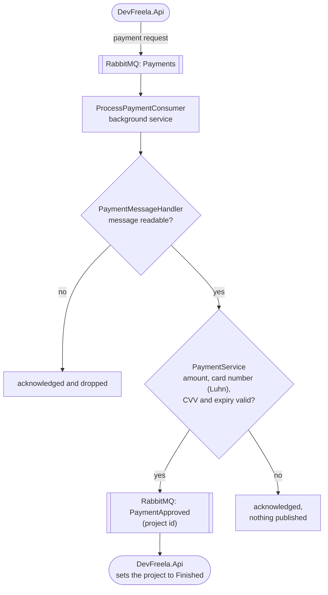

# DevFreela.Payments

[](https://github.com/joaogqueiroz/DevFreela.Payments/actions/workflows/ci.yml)

The payment microservice for [DevFreela](https://github.com/joaogqueiroz/DevFreela). It was split out of the DevFreela monolith to explore service decomposition and asynchronous communication with RabbitMQ.

## How it works

1. When a client finishes a project, the DevFreela API publishes the payment details (project id, card data, amount) to the `Payments` queue.
2. `ProcessPaymentConsumer`, a hosted background service here, consumes the message and runs it through `PaymentService`. The payment gateway is simulated: nothing is charged, but it refuses what a real one would refuse (amount not above zero, a card number that is not 13–19 digits or fails the Luhn check, a CVV that is not 3–4 digits, an expiry that is not `MM/yy` or has passed).
3. Only when the payment is approved does the service publish a payment-approved integration event with the project id, which DevFreela consumes to mark the project as finished. A refused payment or an unreadable message is acknowledged and dropped without an approval.



It also exposes `POST /api/payments`, which runs the same `PaymentService` checks synchronously over HTTP without publishing anything: `204` when approved, `400` when refused.

## Tech stack

C# · .NET 8 · ASP.NET Core · RabbitMQ.Client · BackgroundService · Swagger

## Running locally

Requirements: .NET 8 SDK and RabbitMQ. The connection is set in the `RabbitMQ` section of `appsettings.json` (default `localhost:5672`, guest/guest). The `docker-compose.yml` in the DevFreela repo starts one.

```sh
dotnet run --project DevFreela.Payments.Api
```

It listens on `https://localhost:6001`, the address DevFreela expects in `Services:Payments`.

## Tests

```sh
dotnet test
```

`DevFreela.Payments.Tests` (xUnit, Moq) covers each rule of the simulated gateway (the expiry with a fixed `TimeProvider`), checks that a payment request leads to an approval only when the gateway approves it, and that malformed messages are dropped. Integration tests start the API with `WebApplicationFactory` against RabbitMQ in a container ([Testcontainers](https://dotnet.testcontainers.org/), Docker required) and go through the queues the way DevFreela does: a request on `Payments` produces `PaymentApproved` for the same project, a refused payment or an expired card produces nothing, a bad message does not stop the consumer, and `POST /api/payments` answers `204` or `400`.
